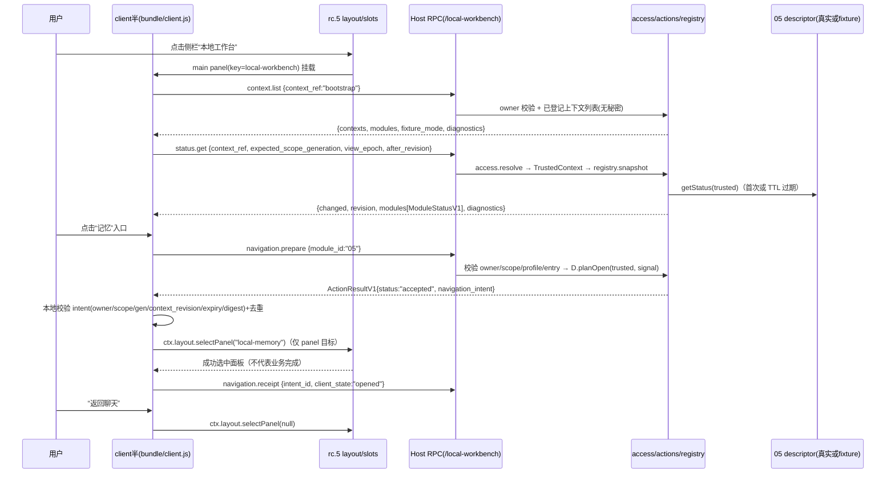

# 08 本地工作台机制说明（供后续 skill 改进）

版本：MECH-08-1；日期：2026-11-07。状态：**首版（stage A）实现机制说明**——已实现并通过自测的是“Harness rc.5 内最小工作台 + 组合事务 + 两个 fixture 模块 + 真实 rc.5 Cordis 运行时挂载”；**05/07 真实能力接入（T5）、完整 profile loader 装载与浏览器内渲染仍是未验证层**，见 §8。后续 skill 修订引用本文稳定机制编号（`WB-*`），编号固定后不回填含义。

对应实现：`src/contracts.mjs`（合同）、`src/compat.mjs`（基线/门禁）、`src/resolve.mjs`/`src/conflicts.mjs`（求解/冲突）、`src/profile-store.mjs`/`src/compose.mjs`（事务/恢复）、`src/access.mjs`/`src/registry.mjs`/`src/actions.mjs`/`src/rpc.mjs`（Host 边界）、`bundle/index.js` + `src/host-rc5.mjs`（Host 装配）、`bundle/client.js`（client 半）、`tools/*`（验收）。证据见 §7。

## 1. 能力与分层（谁负责什么）

| 层 | 08 的职责 | 明确不负责 |
|---|---|---|
| skill | 何时打开工作台、如何解释状态/错误、何时建议用户先处理阻断、组合变更前如何解释影响；回答“下一步做什么” | 不能提高模块状态、不能代替 Host 登记上下文、不能绕过 owner/scope 校验 |
| plugin（Host 半，`bundle/index.js` + `src/host-rc5.mjs`） | 注册唯一 RPC 通道 `/local-workbench`；读取本地非秘密 config；聚合 descriptor 状态；调用所属模块 `planOpen`；提供只读组合预览/应用入口 | 不实现 05/07 业务、不复制数据库、不执行模型/远端操作、不读凭据、不给底层额外数据权限 |
| plugin（client 半，`bundle/client.js`） | rc.5 原生 main panel + 侧栏入口；轮询/展示状态；校验 intent 后仅调用 `ctx.layout.selectPanel`；只读组合差异；可见指令卡 | 不直接读数据库/文件、不自己发 HTTP、不把 `opened` 当业务完成、不自动执行 skill/host_command |
| profile/事务（`src/profile-store.mjs` + `src/compose.mjs`） | 唯一 profile writer：revision、锁、journal、原子切换、恢复；默认 `restart_required` | 不写用户真实 DSH profile（首版仅 scratch）、不恢复业务数据、不热卸载运行中的 Host |
| Host/OS | 真实 Cordis 生命周期、连接鉴权（owner peer）、浏览器渲染、进程/端口/文件权限 | 08 只消费已鉴权连接；OS 出口认证未做 |

凭据/数据/生命周期归属：05 记忆数据归 05，03 会话归 03，02 远端任务归 02/01；08 只保存 profile 组合引用、摘要、journal 与工作台入口，不保存任何秘密。08 自己的状态生命周期跟随其 cordis fiber：插件卸载 → RPC 通道与工作台 runtime 一起 dispose。

## 2. 端到端机制图（可复现的典型旅程：打开工作台→进入记忆→返回聊天）



取消/部分完成/恢复分支：

- 用户切 scope/session 或隐藏面板：client 立即 abort 在途读取、递增 `view_epoch`、清空旧模块详情；迟到的旧响应按 epoch/generation/context_revision 丢弃（`WB-POLL-03`）。
- 模块处于 `busy`/`outcome_unknown`：卡片显示“忙碌”/“结果待核实”，组合切换在 quiesce 非 idle 时拒绝，不伪装取消（`WB-COMPOSE-05`）。
- apply 在切换前失败：旧 current 保留；切换后未验证：由 journal 恢复旧 revision；外部修改：保留双方并报冲突（`WB-RECOVER-01..04`）。
- RPC 传输失败：client 固定 `TRANSPORT_FAILURE`，不展示 Host error.message/details，不自动重发写操作（`WB-RPC-03`）。

## 3. 稳定机制编号与决策规则

| 机制编号 | 场景/触发 | 输入与前置条件 | 判断及理由 | 工具/状态变化 | 输出/证据 | 异常/用户提醒 | 可由 skill 调整 | 硬边界及验证 |
|---|---|---|---|---|---|---|---|---|
| WB-BOOT-01 | 开始真实实现前/每次安装前 | 安装包与归档存在 | 重算 exe/asar SHA256，必须等于冻结基线；从 asar 只读抽取并复核 9 个接缝文件摘要与源码事实 | 只读；不执行归档代码 | `tools/doctor.mjs --isolated`，`evidence/host-rc5/source-manifest.json` | 摘要/探测不符→不安装、不继续，报告 needs_verification | 是否运行 doctor、报告详细度 | 硬边界：基线白名单写在 `src/compat.mjs`，改 skill 不能放宽；`tests/compat.test.mjs` 正负例 |
| WB-VER-01 | 模块带入 catalog | manifest v1 | `checkModuleHostCompat`：host版本必须精确等于 `0.2.1-rc.5` 且 `verified_versions` 含它且 `declared_range` 接受（离线固定 semver 7.8.6）；未知版本只报 needs_verification | catalog 项可能 blocked | `resolveComposition` 诊断；`tests/resolve.test.mjs` | 显示 `HOST_INCOMPATIBLE`，不自动升级/不加白名单 | 无（策略变更需改代码 + 重算 source-lock） | 硬边界：`src/compat.mjs`、`src/resolve.mjs` |
| WB-RESOLVE-01 | 组合求解 | 已锁 catalog、requested ids、locks、policy | 未登记/摘要不符/缺依赖/循环/网络策略/冲突→blocked；Kahn 拓扑 + 固定优先序 05,07,06,03,04,02,01；requested 顺序不影响摘要 | 产出 enabled/disabled/ordered/composition_digest | `tests/resolve.test.mjs`（18） | 诊断指向参与模块，不静默启停 | 是否在 UI 显示诊断细节/排序文案 | 硬边界：拓扑/冲突/摘要算法在 `src/resolve.mjs`、`src/conflicts.mjs` |
| WB-CONFLICT-01 | 两个模块声明资源 | 全部 selected manifests | 同名工具、single slot、keyed/list slot 同 name+key、同 resource writer（global 与任意相交；v1 无不相交证明→保守冲突）、同名 exclusive_mutate hook→error；observe hooks 可共存（info） | 冲突→整体 blocked | `tests/conflicts.test.mjs`（15） | 显示两个 owner；不建议“换个名字藏冲突” | 可调整提示文案，不能改判定 | 硬边界：`src/conflicts.mjs` |
| WB-PROFILE-01 | 准备/应用组合 | scratch root 带 `.workbench-profile` 标记；expected_revision；preview 未过期 | 路径必须本地绝对且无 `..`/UNC/symlink/reparse；评估 revision 与 preview 绑定（TTL 10min） | `prepare` 生成 preview_id+diff+digest；`apply` 持锁写 revision/journal | `tests/compose.test.mjs`（21） | 路径不可信→`PATH_UNTRUSTED`；preview 过期→`STALE_PREVIEW` | 是否先 dry-run、是否解释 diff | 硬边界：`src/profile-store.mjs`；真实 profile 部署未开 |
| WB-COMPOSE-01 | 状态机推进 | preview+expected_revision+operation_id | `validated→staged→quiescing→switching→verifying`；任何阶段失败不进入 active | 写 revision 目录、journal、原子切 current.json | `tools/compose.mjs --fixture` exit 0；`evidence/verification.json` | 忙碌/未知→`QUIESCE_BUSY/QUIESCE_UNKNOWN` 拒绝；失败保留旧组合 | 是否在 UI 展示阶段进度 | 硬边界：状态机在 `src/compose.mjs` |
| WB-COMPOSE-05 | 运行中写操作存在 | descriptor.quiesce 返回 busy/unknown | 只有 idle 才切换；unknown 保持阻断；不向远端任务发送取消 | 组合 blocked | `tests/compose.test.mjs` | 提示等待/人工处理，不承诺“强制卸载” | 提示语与等待策略 | 硬边界：08 不具备取消底层任务权限 |
| WB-IDEMP-01 | 重复提交 | operation_id + digest | 同 operation+同 digest→已知结果、不新增 revision；同 operation 不同 digest→拒绝；current 已同 digest→no_op | 不写盘 | `tests/compose.test.mjs` | 显示“无变化”，不显示“已应用” | 是否重复提示 | 硬边界：`src/profile-store.mjs` |
| WB-RECOVER-01 | 崩溃/中断后的恢复 | journal+current | prepared/staged 未切换→清 staged 保旧；switched 未 verified→重核旧版本身份后恢复；外部修改→保留双方 partial；无法验证→不删除 | journal `recovered`；current 可能回退 | `tools/restore.mjs --scratch ... --dry-run`；`docs/restore.md` | 报告动作与 needs_manual，不覆盖用户新配置 | 是否自动恢复（首版默认需显式命令） | 硬边界：`src/compose.mjs`/`src/profile-store.mjs` |
| WB-ACCESS-01 | 任何 RPC 业务请求 | 已鉴权 owner peer + `context_ref`/`expected_scope_generation` | “owner”不等于项目许可：context_ref 必须已本地登记、active、generation 匹配；客户端不能新增范围；`bootstrap` 只允许 context.list | 构造 TrustedContext；失败固定 reason code | `tests/rpc.test.mjs`；`tests/actions.test.mjs` | `OWNER_REQUIRED/CONTEXT_UNBOUND/SCOPE_REVOKED/STALE_SCOPE` 本地文案 | 可解释文案；不可放宽规则 | 硬边界：`src/access.mjs`、`src/rpc.mjs` |
| WB-RPC-01 | Host/client 业务调用 | 统一请求壳（schema_version/operation_id/context_ref/expected_scope_generation/view_epoch/input） | 未知字段拒绝、decoded JSON≤64KiB、响应≤1MiB；成功 `{status:"ok",data}`，失败固定 `reason_code` 且无 data；handler 全 catch，不抛原始错误 | 业务拒绝仍是 RpcResult 的 value | `tests/rpc.test.mjs`（11）；`tests/host-rpc.test.mjs`（真实 rc.5 Cordis） | 固定本地文案；不展示 Host 路径/堆栈/秘密 | 呈现粒度；不可绕过外壳 | 硬边界：`src/rpc.mjs`、`src/contracts.mjs` |
| WB-RPC-03 | transport `{ok:false}` | connection 返回失败 | client 映射固定 `TRANSPORT_FAILURE`；展示固定文案；不自动重发写操作 | 不改变业务状态 | `tests/client.test.mjs`（36） | 建议重试（读）/人工核对（写） | 是否自动重试只读轮询 | 硬边界：`bundle/client.js` |
| WB-REG-01 | descriptor 注册/聚合 | catalog 内模块 + 合法 release/entry | 单 owner；in-process 函数形状；entry/release 必须与 manifest 一致；invalid status→blocked + diagnostic，不把坏 status 传 UI；每 (context,generation) 只订阅一次 | 聚合 revision 递增；after_revision 未变不回正文 | `tests/registry.test.mjs`（8） | 卡片显示阻断原因与诊断入口 | 卡片排序/刷新提示 | 硬边界：`src/registry.mjs` |
| WB-NAV-01 | 打开某能力 | status 卡入口 + descriptor.planOpen | Host 校验 release/entry/权限并调用 planOpen；intent 必须匹配 owner/scope/generation/context_revision/组合摘要/过期时间（≤5min），panel_key 禁止 conversation/越权路径；client 去重 intent_id；只有 panel 调 `ctx.layout.selectPanel`；skill/host_command 只显示已登记可见指令+复制，不执行 | Host 返回 accepted≠opened；client opened 仅“面板已选中” | `tests/actions.test.mjs`、`tests/rpc.test.mjs`、`tests/client.test.mjs`（36） | 面板未注册/过期/失败→unavailable/stale + receipt；不另找高权限通道 | 指令卡文案、复制行为、是否提示先处理阻断 | 硬边界：`src/actions.mjs`（Host 不调 client 函数）、`bundle/client.js`（只 selectPanel） |
| WB-POLL-01 | 面板可见期间刷新 | 当前 context、view_epoch | 每 1s；同一 view 最多一个在途；`after_revision` 未变化返回 changed:false 不重渲染；hidden 暂停；卸载/切代 abort | revision 聚合；不写业务状态 | `tests/client.test.mjs` | 重要变化用 aria-live polite 非打断 | 轮询间隔/是否手动刷新（需 client 代码） | 硬边界：单在途与丢弃规则在 `bundle/client.js` |
| WB-POLL-03 | 迟到/跨代响应 | 响应 view_epoch/scope_generation/context_revision | 与当前不一致→直接丢弃；generation/revision 变化→epoch+1、abort、清空、重新 context.list；不允许旧响应覆盖新视图 | 本地视图状态 | `tests/client.test.mjs` | 不闪现旧项目数据 | 提示方式 | 硬边界：`bundle/client.js` |
| WB-FIXTURE-01 | 首版无真实模块 | catalog `fixtures:true`、`real_modules:[]` | fixture 仅证明框架/事务/RPC 合同；UI 必须显示“fixture 组合（非真实能力）”；fixture 不得进入真实 release 证据 | fixture descriptor 可注入 state 演示 busy/attention/outcome_unknown | `tools/smoke.mjs`；`evidence/verification.json` | 明确“不代表能力可用” | 是否默认展开 fixture 说明 | 硬边界：catalog/fixture 分离；T5 门禁 `tools/smoke.mjs` 拒接真实 05/07 |
| WB-EGRESS-01 | 运行路径出口 | 所有 src/bundle 源码 | 静态扫描禁止 fetch/http/net/ws/child_process/eval/new Function；只读白名单 env（DSH_WORKBENCH_CONFIG/DSH_HOME/DSH_AUDIT_APP_ROOT）；config 拒绝 URL/绝对路径/秘密字段；错误只回固定码 | 无网络组件注册 | `tests/network.test.mjs`（8） | 网络/凭据相关请求一律拒绝并本地说明 | 无（策略变更需改代码+复审） | 静态证据≠OS 出口认证（未执行） |
| WB-DOC-01 | 版本/接口变更 | 设计变更单需求 ID | 修改 owner 层后重算 manifest/组合摘要、跑映射测试、更新兼容矩阵与 source-lock；Host 版本/权限/网络/writer 变化必须重验相关边界 | source-lock、兼容矩阵、验证记录 | `docs/compatibility-matrix.md` §5 命令 | 不整份重做设计，不做无证据“兼容”结论 | 文档与回归清单组织方式 | 硬边界：`source-lock.json` 摘要由工具校验 |

## 4. 来源、实际复用与设计原因

| 来源 | 实际复用 | 补强/替换 | 理由与代价 |
|---|---|---|---|
| 本机 Harness `0.2.1-rc.5` 归档（exe/asar SHA 见 §7） | 真实 `ctx.connection.rpc.handle/call`、`ctx.slots`/`ctx.layout.selectPanel`、`__ModuleLoader__` client 模块格式、Cordis fiber/effect 生命周期 | 08 自写全部工作台代码；未复制 Host 源码 | 直接依赖真实接缝避免“自造 API”；代价是精确版本白名单与归档摘要核对 |
| 本机已装第三方插件（dsh-context 0.82.0 等） | 仅对照 `package.json` 的 `dsh.bundle.patch`/`dsh.client.inject`/`exports["./client"]`、`cordis.patch.yml`、client 包装与 CSS 注入时机 | 不合入字节、不复制 UI 代码、不作为依赖 | 快速确认 rc.5 真实 bundle 形状；风险是该版本自身行为不代表官方契约 → 已用 asar 官方包复核关键 API |
| dsh-web 固定树（设计冻结，仅调查） | 不采用 | 08 自有最小 UI；不引入 all 包/市场/remote bridge | 其宿主门槛高于 rc.5 且违反最小装配目标 |
| 05/07 及后续能力 | 消费未来 descriptor 公共合同 | 当前 fixture 替代、真实 release 门禁 | 不循环依赖、不把 fixture 当真实能力 |
| 离线固定 semver 7.8.6（ISC，vendor 原字节） | 版本区间判定 | 不自创字符串比较 | 版本门禁可审；代价是 vendor 需锁摘要/许可 |
| 本机 ui-ux 指南 | 可用性原则（非打断 live 区、键盘焦点、内容不遮挡） | 不采用营销页/远程字体 | 符合“Harness 内本地工作台”边界 |

设计原因一句话：08 只做“入口 + 状态聚合 + 组合事务 + 只读诊断”，把底层数据/执行/权限留在各自模块，避免一个巨型插件成为新的权限中心。

## 5. skill 改进接口（哪些能由 skill 调，哪些必须改代码）

**可由 skill/策略调整（不改变安全边界）**

- 打开工作台的时机、开场解释顺序（先 scope/阻断项再卡片）、组合诊断的展开层级。
- 状态文案与建议动作：`busy` 建议等待、`outcome_unknown` 建议先核对而非重试、`blocked` 建议检查原因码对应项；不得把 `accepted/opened` 说成业务完成。
- 是否先要求用户确认组合变更、是否先 dry-run、是否解释 diff/影响；是否提示重启需求（`restart_required`）。
- 轮询失败时的建议（只读可建议重试，写操作建议人工核对）。
- 哪些 fixture/未接入说明默认展开；如何解释“后续接入”而不是画假按钮。
- 何时提示先处理 attention/blocked 再进入能力（决策顺序属 skill）。

**必须改代码/策略才能变（skill 不可绕过）**

- Host 基线白名单与 source-lock 摘要：`src/compat.mjs`、`source-lock.json`（改 skill 不放行未知版本）。
- owner/scope/context 登记与 generation 校验：`src/access.mjs`、`src/rpc.mjs`（不能靠 prompt 放宽）。
- 网络/凭据/出口策略：config 校验 + 静态扫描 + 未来 OS 认证；skill 不能开放新目标。
- writer/hook 冲突判定、quiesce 语义、profile 原子切换/恢复：`src/conflicts.mjs`、`src/compose.mjs`、`src/profile-store.mjs`。
- client 只能 `selectPanel`、不能自动执行 skill/host_command：`bundle/client.js`（改了需重跑 client 测试与真实 Host 层）。
- descriptor 单 owner 与 in-process 校验：`src/registry.mjs`（外部 JSON 不能注册可执行 descriptor）。
- 组合/权限相关 approval 语义（未来）：必须由 Host 授权模型实现，不以 skill 文本替代。

## 6. 证据分层与“没有证明什么”

见 `evidence/verification.json`、`evidence/test-summary.json`、`evidence/host-rc5/source-manifest.json`、`evidence/host-rc5/host24.json`：

- **已证明**：普通 Node 26.13.0 全量 151 项测试（149 pass / 2 项真实 Host 测试按设计跳过 / 0 fail，`evidence/tests.tap`）；合同/严格校验、fixture 双模块求解/冲突/事务/恢复、scratch CLI、Host RPC/registry/actions/access 组件行为、client 半在模拟 rc.5 环境中的加载/轮询/导航/清理（36 项）、真实 rc.5 Cordis 内嵌 Node 24.21.0 下 Host 插件挂载+调用+卸载（2/2）。
- **未证明**：完整 profile loader 装载本 bundle；浏览器内真实渲染/键盘旅程；05/07 真实 descriptor/能力；OS 出口认证；Windows 进程启动时间/真实 profile 原子替换的极端并发。`docs/compatibility-matrix.md` §3 矩阵逐层标注。
- 证据不是“上游项目成功数量”：dsh-context/dsh-pet 只作对照，不构成本项目成绩。

## 7. 固定身份与命令

- Host：`0.2.1-rc.5`，exe SHA `7ae939b5…0cc4`，app.asar SHA `e1b6f25f…6915`，Electron 44.7.0 / 内嵌 Node 24.21.0。
- 测试运行时：`runtime/node.exe` v26.13.0，SHA `14319838…e6d5`。
- 核心命令（从 `08-workbench-ui` 运行）：

```powershell
.\runtime\node.exe tools\doctor.mjs --isolated --host 0.2.1-rc.5
.\runtime\node.exe tools\run-all-tests.mjs
.\runtime\node.exe --test tests\compat.test.mjs
.\runtime\node.exe --test tests\resolve.test.mjs tests\conflicts.test.mjs tests\compose.test.mjs
.\runtime\node.exe --test tests/registry.test.mjs tests/actions.test.mjs tests/rpc.test.mjs
.\runtime\node.exe --test tests/dispose.test.mjs tests\network.test.mjs
.\runtime\node.exe --test tests/host-rc5.test.mjs
.\runtime\node.exe --test tests/client.test.mjs
.\runtime\node.exe tools\compose.mjs --fixture --out .\scratch\compose-smoke
.\runtime\node.exe tools\restore.mjs --scratch .\scratch\compose-smoke --dry-run
.\runtime\node.exe tools\test-rc5-host.mjs
.\runtime\node.exe tools\smoke.mjs --isolated --fixture --network-evidence
```

## 8. 下一次验证（候选改进假设，不是已完成效果）

1. **完整 profile loader 旅程**：在隔离 `DSH_HOME` 创建一个 profile，把本包与 `dsh.client` 声明安装为 bundle，启动 rc.5 Web，验证 `__DSH_BOOT__` graph 含 `@local/dsh-workbench-ui` 且面板/侧栏渲染、返回聊天、键盘旅程；最小反例：故意缺失 `dsh.client.inject` 依赖或错误 client id，应加载失败而不是静默空白。
2. **浏览器内真实 client 渲染**：用隔离实例的 CDP/截图核对 0/1/多上下文、hidden 暂停、scope 切换丢弃迟到、narrow/wide 布局、fixture 横幅；最小反例：注入旧 scope 响应，UI 不得闪现旧项目。
3. **T5 真实 05/07**：05 完整 release + 07 实现后，用真实 descriptor 替换 fixture，保持单 writer/observe 订阅一次/scope 一致；最小反例：两个 05 writer 或 05 缺失时 07 可选依赖处理。
4. **OS 出口认证**：对 Host/Chromium/子进程做实际出口监测；当前只有静态扫描与白名单，不能把静态证据当认证。
5. **真实 profile 部署/回滚**：非 scratch 的可审差异、备份、离线闭包、Windows 原子替换并发；最小反例：共享占用时保持旧 current。
6. **skill 行为改进验证**：用脚本化对话验证 skill 在 `blocked/busy/outcome_unknown/restart_required` 下不虚报完成、不过早建议重试；需要新的 skill 评估用例而非本文承诺。
