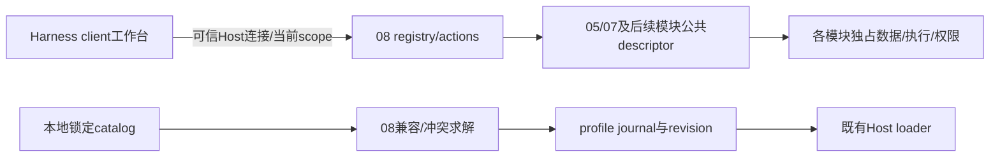

# 08 Harness 最小工作台与模块装配：软件设计

版本：UI-DESIGN-2；日期：2026-11-07；状态：编码设计，功能未实现；独立评审状态见根[评审报告](../../docs/design-review-surfaces.md)。本轮只设计，不安装、不启动真实profile、不读凭据、不调用模型。优先级第三；先交付工作台框架与已验收05/07入口，再按06→03→04→02→01接入。正式开工应另留 `implementation-route.md`，旧PLAN中的合成装配任务继续有效，以本设计冻结接口。

| 修订 | 来源/变更 | 影响ID/验证状态 |
|---|---|---|
| UI-DESIGN-1 | 2026-11-06用户确认Harness内工作台；补本机rc.5 UI源码接缝、组合事务和局部映射 | UI-01—08；归档只读核对，功能/完整Host/出口未验证 |
| UI-DESIGN-2 / 2026-11-07（现行） | 独立评审SR-01/02：真实RPC/registry许可；Host导航intent与client导航分离；产品选择见[产品说明](product-form.md) | UI-04/05/07；新增UI-RPC-01、UI-NAV-01；仅设计修订，功能/Host/出口未验证 |

## 1. 用户得到什么

最终产品是在现有 Harness 中打开的“本地工作台”：同一处查看已启用能力、当前项目/会话、操作进度与错误，进入记忆、上下文、图示、会话、代码学习、远端环境、浏览器认证。现有聊天、会话和Provider继续由原Harness拥有。08只做入口、状态聚合和已审组件组合，不能重新解释底层操作成功，更不能给底层额外数据权限。

既有依据：Harness内、最小plugin bundle+本地profile、按需装配、禁止全家桶/市场下载/同步/隧道、唯一writer/工具/hook、精确版本门禁、分阶段接真实模块。高层产品UI-PF-01已由用户在本轮集中明确回复：Harness内统一工作台。界面布局、CSS、冲突图算法、文件名由开发自主决定，不逐个询问；不以独立Web应用替换已确认形态。

首版旅程：

1. 用户从Harness本地工作台入口打开中心面板。页头显示当前项目、当前会话和“运行组合revision”，可返回聊天；不劫持启动页或重建侧栏。
2. 只展示实际接入并验证的05/07入口；用户点记忆进入其管理面板，点上下文进入其观察面板。底层未就绪显示明确阻断原因和诊断入口。其他模块在“后续接入”列表展示名称/状态，不画可执行假按钮。
3. 每张能力卡显示`可用/忙碌/需处理/不兼容/停用`及最近操作；状态来自模块合同。操作日志只含非秘密状态/引用，正文由所属模块授权页面提供。
4. 用户可打开组合诊断，查看实际版本、缺服务、冲突owner和可恢复的profile变更记录。启停能力先生成差异预览，Host管理入口执行既有授权动作；运行中的写操作需等所属模块静止，不能“强制卸载”伪装取消成功。
5. 重启失败时按本地journal恢复到上次已验证组合，显示待人工处理项。停用08只移除工作台入口，不删除05数据库/会话/图示或02远端任务。

首版范围：两个无网络fixture→真实rc.5 loader/client→已独立完成05/07的入口与状态；08的发布不等待八项全完成。05/07未完成前可验框架，不能把fixture标实际能力可用。最终全八组合是后续增量形成的验收。

后置：可选右侧停靠、必要的dsh-web单子包、保存布局偏好、跨模块批处理。明确不做新聊天后端、Provider聚合、数据库/凭据存储、通用任务执行器、远程web控制台、市场、皮肤下载、Git同步、APNs/relay、公网隧道和自动宿主升级。

## 2. 路线和逐来源采用方式

首个可验交付：在scratch profile中两个合成模块能确定解析为一个无网络组合；工具重名和重复writer被拒绝；两次相同装配不多写一版；失败可回前版。随后才进入真实Host/client和05/07。

| 来源与固定身份 | 借鉴机制/实际采用 | 采用分类与边界 |
|---|---|---|
| 本机Harness 0.2.1-rc.5，Node24.21.0/Electron44.7.0；asar SHA `e1b6f25fa937da98086c3e77af77aa14791105963c4d337a1c42179d232c6915` | 原生bundle/profile、Cordis effects、client keyed main slot、layout导航 | 运行时直接依赖和薄适配；MIT包manifest见05 Host证据。本轮只读归档，完整profile loader/client旅程未运行 |
| [dsh-web](https://github.com/zhu1090093659/dsh-web/tree/975ba292d5803f9a4e6df6ba3c25ed44e567f3ac)固定树 `975ba292d5803f9a4e6df6ba3c25ed44e567f3ac`，调查包dsh-web-all 0.4.14，Apache-2.0 | 模块化patch和工作台入口的对照；调查发现市场/remote bridge/GitHub扩展等附加路径 | 仅调查，不合入all包。all要求宿主`>=0.2.2-alpha.3`，不满足rc.5，不借version exemption绕过；确有缺口才另锁可兼容子包 |
| 05/07及后续各能力 | 提供入口descriptor、scope状态、release证据、disposer | 消费明确公共合同；不复制其数据库/Agent逻辑。05仍in_progress，未声称已装入 |
| 本地ui-ux-pro-max guidance | 状态提交反馈、键盘与可见焦点、内容不被固定导航遮挡 | 仅可用性原则借鉴；检索返回的FAQ营销落地页/远程字体不适合本工作台，不采用 |

自有实现部分：严格manifest、组合求解/冲突诊断、profile事务和工作台React组件。默认无上游web大包源码复制。将来若采用某个dsh-web子包，必须补精确package/commit/摘要、许可/NOTICE、依赖闭包、实际所需slot、出口审计；不能把上表调查身份当可装制品锁。

source-lock v1包含 `schema_version, host:{version,exe_sha256,asar_sha256,runtime}, artifacts:[{id,path,sha256,size,package,version,license,license_ref,source_ref}], selected_modules[], evidence_refs[]`。模块manifest和实际构件必须一致，未知字段拒绝，少字段不默认放行。

## 3. 已核的rc.5接缝与实施后备

已有05证据确认AppBoot读取`dsh.bundle.patch`、`bundlePatchPaths`、`engines.dsh`；`await ctx.plugin(plugin)`等待加载、fiber.dispose清理。`installBundle`会走pnpm add，绝对本地路径不等于离线；08不在运行中调用安装器、不自动补peer、不更改生产profile。

本轮为设计只读解析 `E:/dsh/resources/app.asar` 头和指定本地文件，无导入执行、无凭据读取。基线同05已有SHA；以下文件可在后续T1按归档路径重新算摘要：

| 归档内文件（前缀dsh/node_modules/@deepseek-ai/） | SHA256 | 已见源码事实 |
|---|---|---|
| dsh-client-ui-layout/package.json | `0c4e082e7600caba8d946a7a5b08a5f9be31d74dca4241aaaaf66ead20e01c24` | 0.2.1-rc.5，MIT，exports `./client`→lib/client.js；dsh.client.inject声明 |
| dsh-client-ui-layout/lib/client.js | `eb011a7b5699fac7f3ad0aa15408f46a6cf47f79b8cc15db1f81739e81e70587` | `ctx.slots.register`在root下声明main为keyed/root；`ctx.layout.selectPanel(id|null)`；beginNavigation取消旧导航 |
| dsh-client-ui-renderer/lib/client.js | `dbdb3f26bfbc1d143bc8a0eed5982a2507c4f0cf8027e7c170f3bed3604be356` | slots.inject/register由ctx.effect管理；未声明slot/所有权违规拒绝 |
| dsh-client-ui-sidebar-right/lib/client.js | `87e13d16e47b9eb00f8f25096d2c674ebe71a31026161a10d7c89ad6e6dfe379` | sidebarRightTabs/register及会话绑定停靠；作为后置对照，不首版依赖 |

首版确定绑定：client模块 `ctx.slots.inject('main',()=>ctx.slots.register({name:'main',key:'local-workbench'},WorkbenchPanel))`；通过 `ctx.layout.selectPanel('local-workbench')`进入，`selectPanel(null)`返回聊天。入口按钮在已有声明的slot注册，优先使用原生插件设置/快捷入口；其具体slot与client command注册类型由T1从同基线确认。即使该入口位不可用，主面板与导航合同仍固定，Host插件的管理页可提供打开动作；若管理入口也不可实现则明确UI blocked，不用独立网页冒充Harness内产品。这里没有假定不存在的`registerPanel()`私有方法。

薄UI不自己注册root/sidebar/rightbar单例，不全局覆盖Host CSS。独立能力可各有main key，08只导航：05=`local-memory`（待05公开合同固定后映射），07=`local-context`，06=`local-diagrams`。原有模块入口key不符时在08descriptor里映射，不能偷改别的插件。

兼容策略是精确基线白名单 + 服务形状探针，两者都要过。正常semver使用离线固定semver包，不自创字符串比较；baseline锁进一步要求`host_version==='0.2.1-rc.5'`。未核的新版本显示needs_verification，不自动沿用旧结论；过高门槛拒绝，无降级全家桶路径。UI缺失但核心装配可用时只交付diagnostic CLI/scratch构件，Harness内工作台验收尚未通过。

## 4. 模块目录和ownership

```text
bundle/index.ts                 # Host bundle生命周期和已选组件挂载
bundle/client.tsx               # 原生client main入口+工作台descriptor
bundle/cordis.patch.yml         # 仅审核白名单组件，无动态URL/表达式输入
profile/base.json               # 不含用户凭据/Provider的最小本地组合
profile/components.json         # 已锁构件catalog，非市场清单
src/contracts.mjs               # manifest/composition/status严格v1 schema
src/compat.mjs                  # 真实版本、构件摘要、导出/服务形状探针
src/resolve.mjs                 # 依赖DAG、确定拓扑顺序、可用性
src/conflicts.mjs               # 工具/slot/writer/独占hook冲突
src/profile-store.mjs           # revision、路径身份、CAS与journal
src/compose.mjs                 # stage/activate/rollback状态机
src/registry.mjs                # 模块descriptor注册和单owner服务
src/actions.mjs                 # UI调用转发；不实现底层业务
src/events.mjs                  # 本地状态聚合与去重/缺口重读
src/host-rc5.mjs                 # 实际loader/配置和fiber adapter
ui/WorkbenchPanel.tsx           # 卡片、状态、入口、诊断
ui/ModuleDetails.tsx            # 来源/版本/恢复信息；无秘密原文
ui/ProfileDiff.tsx              # 插件增删改预览与重启状态
ui/workbench-store.ts           # view epoch和订阅清理
ui/workbench.css                # 局部样式、Host主题变量
tools/{doctor,compose,smoke,restore}.mjs
tests/{compat,conflicts,compose,registry,actions,dispose,network}.test.mjs
docs/{implementation-route,compatibility-matrix,restore,mechanisms}.md
```

08唯一拥有profile组合writer和工作台导航。05拥有memory持久层/召回，07拥有context observe/maintain，06拥有diagram保存，03拥有rewind，04拥有学习编排，02拥有remote运行，01拥有browser/auth。08可以展示一个owner但不得“帮助修复”而另写同一数据库。重叠writer默认冲突，不支持静默优先级覆盖。



## 5. 版本化manifest和模块接口

```ts
type ModuleManifestV1 = {
 schema_version:1; id:'01'|'02'|'03'|'04'|'05'|'06'|'07';
 name:string; release_version:string; artifact_ref:string; sha256:string;
 host:{verified_versions:string[]; declared_range:string;
       services:{name:string; shape_revision:string}[]};
 requires:{module_id:string; contract_major:1; optional:boolean}[];
 provides:{
   tools:{name:string; operation_kind:'read'|'write'}[];
   slots:{name:string; key:string|null; mode:'single'|'keyed'|'list'}[];
   writers:{resource:string; scope:'global'|'scope'|'session'}[];
   hooks:{name:string; mode:'observe'|'exclusive_mutate'}[];
 };
 network:{mode:'none'|'approved_model'|'trusted_targets';
          target_refs:string[]};
 dispose:{supports_quiesce:boolean; timeout_ms:number};
 entry:{kind:'panel'|'host_command'|'skill'; ref:string};
 evidence:{release_ref:string; contract_tests_ref:string;
           host_smoke_ref:string; network_ref:string};
};
type ProfileV1 = {
 schema_version:1; profile_id:string; revision:number;
 host_version:'0.2.1-rc.5'; module_refs:{id:string; sha256:string}[];
 policy_ref:string; policy_digest:string; composition_digest:string;
};
type ModuleDescriptorV1 = {
 contract_version:1; id:string; release_version:string;
 entry:{kind:'panel'|'host_command'|'skill'; ref:string};
 getStatus(context:TrustedContext):Promise<ModuleStatusV1>;
 subscribe(context:TrustedContext, listener:(s:ModuleStatusV1)=>void):()=>void;
 planOpen(context:TrustedContext, signal:AbortSignal):Promise<NavigationIntentV1>;
 quiesce(signal:AbortSignal):Promise<{status:'idle'|'busy'|'unknown'}>;
 dispose():Promise<void>;
};
```

manifest是构建时数据，descriptor是运行中服务；模型/外部JSON不能注册可执行descriptor。tools为Host实际注册后的可核清单，不以manifest声称拥有某工具。release证据未齐的模块只能为fixture/unverified，不能上可用卡片。optional依赖缺失只关闭关联feature，不从网络补包。

```ts
type TrustedContext = { scope_ref:string; scope_generation:number;
 session_ref:string|null; caller_ref:string; context_revision:string };
type ModuleStatusV1 = {
 schema_version:1; module_id:string; scope_ref:string; session_ref:string|null;
 generation:number; revision:number;
 state:'ready'|'busy'|'attention'|'disabled'|'blocked'|'unavailable';
 reason_code:string|null; active_operations:{operation_id:string;
   kind:string; state:'queued'|'running'|'cancelling'|'outcome_unknown'}[];
 updated_at:string; capabilities:string[];
};
type ActionResultV1 = {schema_version:1; operation_id:string;
 status:'accepted'|'denied'|'stale'|'unavailable';
 owner_module:string; reason_code:string|null;
 navigation_intent:NavigationIntentV1|null};
resolveComposition({host,requested_modules,locks,policy})
 -> {status:'valid'|'blocked'; enabled:string[]; disabled:Diagnostic[];
     ordered:string[]; composition_digest:string; diagnostics:Diagnostic[]}
inspectConflicts(manifests) -> Diagnostic[]
prepareComposition({profile_ref,expected_revision,selected_ids},caller)
 -> {preview_id,diff,composition_digest,expires_at}|rejected
applyComposition({preview_id,expected_revision,operation_id},caller,signal)
 -> active|stale|denied|restart_required|rolled_back|partial|outcome_unknown
```

`caller/TrustedContext`由可信Host绑定；UI只能选择它已获准的引用。不能因08可见当前project名就认为有读写权。`context_revision`在切project/session、scope撤销时变化，操作入站复核且所属模块再次授权。诊断固定 `{code,severity,module_ids,resource_ref,message_key,evidence_ref?}`，禁止放原始错误堆栈/配置值。severity=error阻断；warning不能掩盖缺实际服务。

严格schema：ID/版本/摘要必填；unknown字段拒绝；单次最多32个manifest、依赖边256、诊断1000条；文本字段最大512字符；target_refs只是可信registry引用，不接受URL。工具命名建议带模块前缀，但与现有工具整合时按实际名字冲突检测，不能通过改显示名藏冲突。

## 6. 求解、冲突与装配算法

### UI-RPC-01 / UI-NAV-01：具体传输与导航分工

rc.5实际Host注册为`ctx.connection.rpc.handle('/local-workbench',async(endpoint,payload,signal,peer)=>...)`，client调用`ctx.connection.rpc.call('/local-workbench',endpoint,payload,signal)`。源码`dsh-client-connection/lib/index.js` SHA256 `0ebcca7583e082716f79b0b55bc1749d48269cc8db2989b043b321b57abd3684`的724、855—871、910；client `lib/client.browser.js` SHA256 `dfc3544eb894c74b340a4c4c63a8c125fd2e983df9efed5885712574af994e62`的1212。注册由fiber dispose自动解除，业务层仍显式取消自己poll和在途动作。`subscribe`是Host内部函数；不把listener或可执行descriptor序列化到前端。

首版handler只接受真实`peer.principal.kind==='owner'`且存活。Host的Host/Origin/认证门禁不等于项目许可，浏览器会话共享owner Peer；`src/access.mjs`持本地可信`WorkbenchAccessRegistryV1 {schema_version:1,revision,contexts:[{context_ref,scope_ref,scope_generation,session_ref,allowed_module_ids:string[],active:boolean}],profile_refs:string[]}`。contexts来自已登记项目与真实Host会话，profile_refs由本地配置登记；前端参数不新增范围。每次lookup核当前代次与关联，底层模块拿可信context再独立授权。owner但无该scope/profile登记仍拒绝，不因工作台显示名字而放行。新增`src/rpc.mjs`绑定schema/错误，`ui/client-navigation.ts`唯一执行client导航。

统一请求`{schema_version:1,operation_id,context_ref,expected_scope_generation,view_epoch,input}`，未知字段拒绝、decoded JSON≤64KiB、响应≤1MiB；需验证锁定Host buffered RPC的全局body上限，未证传输层资源限额时不暴露给不可信远程。业务成功`{schema_version:1,operation_id,view_epoch,scope_generation,status:'ok',data}`；失败同外壳但`status:'denied'|'stale'|'invalid'|'unavailable'|'failed',reason_code`且无data。reason_code白名单：`OWNER_REQUIRED/CONTEXT_UNBOUND/SCOPE_REVOKED/PROFILE_DENIED/MODULE_DENIED/STALE_SCOPE/STALE_REVISION/UNKNOWN_ENDPOINT/LIMIT_EXCEEDED/INTERNAL_FAILURE`等登记枚举。全handler catch后只返回固定码；禁止Host默认500里的String(error)带出路径、profile、stack或秘密。

**RpcResult传输合同（SR-01补正）**：上述带status/data的对象是业务响应BusinessResponse，不是实际RPC外壳。锁定connection源码的serverResponseSchema（Host 621—642、938）要求handler返回`{ok:true,value:BusinessResponse}`；包括denied/stale/failed等业务拒绝也放在value，插件catch全部异常后生成固定INTERNAL_FAILURE业务响应，不抛原Error。client的`rpc.call`返回RpcResult本身，不自动unwrap：先检查`result.ok`，仅为true时validate(result.value)后再检查view_epoch/scope_generation和业务status。Host连接层可能返回`{ok:false,error:{code,message,details}}`；客户端映射为固定TRANSPORT_FAILURE，不展示原message/details且不自动重发写操作。插件不自行双包type/rpcId，它们由connection管理。T2/T4/T5按本能力执行一条实际handle→call正常、业务拒绝、transport失败、旧epoch及异常金丝雀用例；仅模拟返回BusinessResponse不能认证RPC可用。


| endpoint | input | data/副作用 |
|---|---|---|
| `status.get` | `{after_revision?:number}` | `{changed,revision,modules:ModuleStatusV1[]}`；只列已登记且allowed模块，不执行open |
| `navigation.prepare` | `{module_id}` | ActionResultV1；Host校验可用release/entry/权限后调用descriptor.planOpen，只返回数据intent |
| `navigation.receipt` | `{intent_id,client_state:'opened'|'instruction_shown'|'unavailable'|'stale',reason_code?}` | `{recorded:boolean}`；仅诊断回执，不成为业务成功或权限凭证 |
| `composition.preview` | `{profile_ref,expected_revision,selected_ids}` | prepareComposition的预览；profile_ref还必须在registry |
| `composition.apply` | `{preview_id,expected_revision}` | applyComposition；operation_id取外壳；配置写入不由浏览器直接操作 |
| `operation.get` | `{operation_ref}` | `{state,phase,reason_code,recovery_refs}`；只查本上下文/登记profile所属操作 |

默认每1秒轮询status.get，同view一个在途，after_revision没变不重复正文。切scope/关闭/卸载abort并清空，旧view_epoch/代次/模块revision回执丢弃。Host内部descriptor订阅只注册一次，聚合revision递增，不做每客户端重复监听。

```ts
type NavigationIntentV1 = {
 schema_version:1; intent_id:string; operation_id:string;
 owner_module:string; scope_ref:string; scope_generation:number;
 context_revision:string; module_revision:number; composition_digest:string;
 expires_at:string; // 默认30秒；绑定创建请求和当前scope
 target: {kind:'panel';panel_key:string} |
         {kind:'skill';skill_ref:string;instruction_key:string} |
         {kind:'host_command';command_ref:string;instruction_key:string};
};
type ClientNavigationAdapter = {
 execute(intent:NavigationIntentV1,currentView):
  Promise<{state:'opened'|'instruction_shown'|'unavailable'|'stale';reason_code:string|null}>;
};
```

Host descriptor不调用client ctx/layout，不返回opened；状态accepted仅指intent已受理。client固定白名单adapter核intent当前scope/generation/context_revision、组合摘要、过期时间及目标在激活构件中登记后，**仅panel**调用实际`ctx.layout.selectPanel(panel_key)`。该方法同步检查已注册main panel，未注册会抛错；捕获并显示unavailable。成功选择后本地显示opened（含义只为已选中面板），所属面板自身loading/ready/failed独立展示，不能据此称底层任务成功。intent_id本地去重，重复不跳转两次；scope切换撤销旧intent，原布局beginNavigation不能代替本地view_epoch核验。返回聊天只调用`selectPanel(null)`。

首版skill/host_command没有核准的通用执行接缝，采用确定的可见指令卡＋复制入口：instruction_key/skill_ref/command_ref均由本地catalog查固定文案，显示instruction_shown，不送入聊天、不自动执行shell、不按远端字符串组装命令。未来若锁定真正Host执行API，再新增adapter并保留所属模块授权，不能拿command_ref当任意代码入口。receipt是可伪造的客户端呈现回执，最多供诊断，Host不以它提升ready、完成任务或释放事务门禁。

T4负例加：Host端planOpen无法调用client函数；正常panel/返回聊天、未知/未注册panel、旧scope/过期intent/乱序响应、重复intent、skill指令复制均有确定状态；owner未授权项目、伪造身份和带秘密异常通过真实channel被拒绝或脱敏。此处是确定软件设计，真实Loader/client/出口仍未运行。

### 6.1 组合求解算法

1. 从本地catalog查requested IDs，拒绝未登记/摘要不符、manifest release与包不符、闭包缺依赖。用已锁离线semver验证declared_range，再核host verified_versions含实际rc.5；未知版本不猜。
2. 对依赖建DAG，Kahn拓扑排序，同层按既定优先序05、07、06、03、04、02、01稳定排序；循环返回所有参与ID。不把08自己放进需要所有模块的环。
3. 检查服务shape_revision与真实导出，在构件加载前做非执行manifest校验，在隔离加载时做实际方法签名/行为探针；“名字存在”不等于兼容。
4. 对tools完全同名、single slot同名、keyed slot同name/key、writer同resource+可能相交scope、exclusive_mutate hook同name报冲突。global writer与任意同resource writer相交；动态scope无法证明不相交时保守冲突。observe hooks可共存，但每个必须证明透明/dispose。list slot可共存但重复key拒绝。
5. 计算规范JSON摘要（固定键顺序、数组按合同顺序、无绝对机器路径/秘密），得到composition_digest。返回清楚的blocked原因，无自动安装/升级/豁免。

冲突解决是改变明确选择或修改owner公共合同后重新审查；不能最后加载者胜出。08入口只注册一个keyed main，不争root/sidebar单例；UI不挂额外Provider或隐藏turn mutation。

## 7. Profile事务、幂等和恢复

profile布局为本工具创建的登记根：`profiles/<id>/{current.json,revisions/<n>/profile.json,revisions/<n>/cordis.patch.yml,journal/<op>.json}`。所有路径从可信profile_ref解析，拒绝..、UNC/网络盘、root外junction、重解析点/符号链接、身份变化。实际平台安全路径证明是门槛；不能只做字符串startsWith。首轮只写scratch。正式profile部署按根既有安装授权，但需先产出可审差异与备份并验证离线闭包，不新增“是否允许安装”的重复问答。

状态机：`draft → validated → staged → quiescing → switching → verifying → active`。失败从switching/verify进入`rolling_back → rolled_back`，恢复失败转`partial/outcome_unknown`；从validated/staged可cancelled。preview绑定expected_revision、composition_digest、policy_digest，TTL十分钟；任意变化拒绝旧preview。配置热更新不是首版默认：需要变更Host加载树时写新revision并返回`restart_required`，下一次隔离boot验证，不在真实会话中半卸载半装载。

实现事务：profile单writer使用排他创建lock文件，内含pid+process_start_token+op；不能只检查pid重用。lock存在先判进程，无法证明退出则busy；不抢锁。写staged revision临时目录，文件fsync后目录封存；journal持久`prepared`→原子更新current指针→记`switched`→在独立DSH_HOME启动合成验收→记verified/active。原子rename仅在同卷、平台支持探针通过的范围使用；Windows分享占用失败则保持旧current并返回失败。加载器读current指针由启动入口解析，不能在既有Host中假定其能动态追踪自定义指针。

进入quiescing向每个将卸载/变更模块调用quiesce，只有idle可切换。busy提示等待；unknown保持阻断。08取消自己的组合操作只撤销未切换stage，不向底层远端任务发送取消；底层取消必须通过其公开有权限动作。切换完成后用户取消不返回“无变化”。

幂等键operation_id + profile_id：相同operation/相同digest返回已知状态；同operation不同digest拒绝。current已是同digest直接no-op，不新增revision。崩溃恢复读journal：prepared且current未切换→清本工具staged；switched但未verified→标attention并用保存的previous_revision恢复（核摘要/身份）；无法确认loader仍有旧fiber或current被外部改动→partial，不能覆盖用户新配置。生产恢复不自动删除不属于本工具的文件。

profile有外部修改→revision/hash冲突，只生成差异报告，保留双方；不能读新revision替旧预览补token继续写。恢复保留最新业务数据，只切组件组合，不恢复05/03数据库。schema_major未知拒绝操作；profile版本迁移产新revision、原版不覆盖。备份保留默认最近5个已验证组合与所有未解决journal，不宣称是数据备份。

## 8. UI状态、可用性与管理体验

布局：顶部scope/session/返回聊天；中部已启用模块卡片；底部“需处理”和组合诊断；后续接入可折叠只读列表。无需大仪表盘和虚构指标。不做08自身跨模块全文索引。每卡显示名称、owner版本、状态文字、最后更新时间和主要入口；`outcome_unknown`文字显示“结果待核实”，与失败/排队分开。

操作流程loading→明确结果；按钮忙时保留文本和取消本地等待操作；错误贴近触发位置，焦点移到错误摘要。键盘Tab顺序与视觉一致，原生button、可见焦点、label；状态不只靠颜色。Host明暗主题与系统本地字体，正文至少14px/1.5行高，长路径折行；不为推荐字体访问Google/CDN。不用emoji作唯一图标，不增加全局动效，尊重reduced-motion。

中心面板窄于640px卡片改单列，宽屏两列，内容溢出不覆盖原会话控制；键盘可返回聊天，状态刷新用非打断live区域只报重要变化。切scope/session立即abort旧读取、增加view_epoch、清空旧module details；迟到status校验scope/generation/revision后才显示。每模块最多一份status订阅，面板关闭清理，后端聚合只保留非秘密状态的有界缓存。

动作只调用Host descriptor.planOpen产生白名单导航intent，再由client导航adapter执行；首版skill/host_command仅显示已登记指令卡和复制入口。Host返回accepted不表示已打开，client本地opened只表示面板已选中，不表示业务完成。模块权限拒绝显示reason_code的本地文案，不试另一高权限通道。

## 9. 跨模块事件、组合递进与出口

状态事件v1：`{schema_version:1,event_id,module_id,scope_ref,session_ref?,generation,revision,operation_id?,kind:'status_changed'|'needs_attention'|'disposed',occurred_at}`；不含正文。消费者按event_id去重、按module+scope保留最高generation/revision，发现跳号重新getStatus；不能以事件缺失推定空闲。03领域事件不在08重新定义成全局事务：仅触发受影响卡片刷新，04/05/07由各自消费者处理stale。

真实接入阶梯：

| 阶段 | 组合和新验收 |
|---|---|
| A | fixture05/fixture07：版本、冲突、恢复；明确标fixture |
| B | rc.5完整Host/client + 已验收05/07：scope一致、入口导航、observer不重复/记忆单writer；交付最小工作台 |
| C | +06：离线图示入口、编辑未启用不能显示可写；图输出scope一致 |
| D | +03：回退preview/unknown状态，04/05/07 stale事件仍由owner处理 |
| E | +04：skill入口/证据Viewer，不复制Atlas索引 |
| F | +02：远端运行由MCP/skill持有，08只读状态和打开受控日志 |
| G | +01：浏览器/凭据在所属plugin，本工作台不接触cookie/token；全组合回归 |

05/07各自可无08运行，08依赖已选版本descriptor而非模块私有函数。状态schema不兼容→该卡blocked，其他模块继续；安全/全局writer冲突则组合整体blocked，不能半启动后假称有效。

08运行路径网络mode固定none；没有模型调用，不读env keys、Provider配置和凭据。复用Host已鉴权连接，scope在Host再次校验。profile只记录目标引用/策略摘要，不展开秘密。所有前端资源构建内嵌或同源本地；无市场、更新、字体/图标CDN、remote bridge、GitHub、通知、cloudflared组件。不能以dsh-web按钮隐藏代替移除注册行/依赖闭包检查。

出口验收覆盖冷启、profile解析/错误/恢复、点击诊断、关闭/卸载，监测Host/Chromium/子进程。Node guard只是探针，不认证OS范围；CSP/Origin/Host鉴权和运行隔离共同实施。可信目标新增是策略变更，08不因UI便利放开网络；其他模块既有API出口不由08扩大。

## 10. 具体任务与验收命令

以下未执行；`runtime/node.exe`/脚本在实施时离线准备。每任务先写能发现真实坏行为的失败用例，再最小实现，再同命令验证并留摘要；不初始化Git或提交。未知性能标准不捏造成用户验收阈值。

| 任务/ID | 文件和明确交付 | 命令与正负例 |
|---|---|---|
| T1 / UI-01 | source-lock、contracts/compat、归档接口证据；固定实际client构建链与入口slot | `./runtime/node.exe --test tests/compat.test.mjs`；`./runtime/node.exe tools/doctor.mjs --isolated --host 0.2.1-rc.5`：实际rc.5导出/slot通过，all高版本拒绝、unknown导出/包摘要不符拒绝；新Host不能自动承认 |
| T2 / UI-02 | resolve/conflicts与两个fixture | `./runtime/node.exe --test tests/conflicts.test.mjs tests/resolve.test.mjs`：依赖确定顺序；重复memory writer、同工具、同key、独占hook、循环依赖都blocked；observe透明共存，未选模块不启用 |
| T3 / UI-03 | profile-store/compose/journal/restore，仅scratch | `./runtime/node.exe --test tests/compose.test.mjs`；`./runtime/node.exe tools/compose.mjs --fixture --out ./scratch-profile`：stale revision拒绝，重复no-op；磁盘满、锁占用、pointer切换崩溃、外部修改恢复保留双方，不改用户profile |
| T4 / UI-04,05 | registry/actions/WorkbenchPanel和真实main入口；两个fixture完整Host/client | `./runtime/node.exe --test tests/registry.test.mjs tests/actions.test.mjs tests/dispose.test.mjs`；`./runtime/node.exe tools/smoke.mjs --isolated --fixture`：返回聊天、scope切换旧响应丢弃、键盘旅程、忙模块不强卸载、卸载监听/进程清理 |
| T5 / UI-06,07 | 05/07真实descriptor、完整出口/恢复 | `./runtime/node.exe tools/smoke.mjs --isolated --modules 05,07 --network-evidence`：只用独立验收release；无重复05注入/07观测；假秘密不进status/profile；错误/更新路径零未登记网络；未有真实release时该项不能打勾 |
| T6 / UI-08 | 06→03→04→02→01逐一接入source-lock/兼容矩阵 | 每次 `./runtime/node.exe tools/smoke.mjs --isolated --modules <当前白名单> --network-evidence`；覆盖新增能力动作、退出、互不越权，改Host需重跑全部组合 |
| T7 | docs/mechanisms.md、restore、发布构件与独立评审 | 按机制合同对应真实接口/命令/失败恢复；完成门禁后按根现有授权安装，不新增API许可；08本身不发模型请求 |

验证记录v1：`schema_version, host_version, host_archive_sha256, runtime_version, source_lock_sha256, module_digests, profile_revision, fixture, command, exit_code, pass,fail,skip,evidence_refs,limitations`。静态manifest通过、安装库通过、完整UI通过、OS出口通过分层记；任何一层缺失不能说“已完整兼容”。

## 11. 局部需求变更地图

| ID | 需求 | 实现位置/公共接口 | 必须回归 |
|---|---|---|---|
| UI-01 | 真实基线和供应链门槛 | compat/source-lock / resolveComposition | compat、doctor、版本负例 |
| UI-02 | 唯一owner和最小组件选择 | resolve/conflicts / ModuleManifestV1 | 工具/slot/hook/writer/DAG |
| UI-03 | profile一次切换与可恢复 | profile-store/compose / applyComposition | 幂等、磁盘故障、崩溃、外改 |
| UI-04 | 原Harness内入口/返回/状态反馈 | bundle/client、WorkbenchPanel / descriptor.planOpen＋ClientNavigationAdapter | Host/client导航、键盘/主题/窄宽 |
| UI-05 | scope与运行生命周期不串扰 | registry/actions/workbench-store | A/B切换、撤权、迟到响应、卸载 |
| UI-06 | UI无额外出口 | bundle/manifest/CSP/网络策略 | 冷启/错误/恢复/卸载全进程出口 |
| UI-07 | 05/07独立真实接入 | descriptor桥接/兼容矩阵 | 单writer、来源/订阅、status真实 |
| UI-08 | 后续逐项组合 | catalog/descriptor/release证据 | 新增模块及受影响组合回归 |

变更流程：遵循根 `docs/design-change-policy.md`，先给需求ID并查owner→只修改该模块descriptor/manifest或08对应层→schema破坏变更升major并给显式迁移，不猜旧结构→重算构件/组合摘要→运行映射测试与新增模块组合→更新兼容矩阵和机制ID。换卡片文案/顺序不会触发底层全量测试；新增动作权限/出口、变更writer/Hook、升级Host则必须重验相关安全/状态边界。产品形态/首版范围实质改变才提交高层确认，不把每个组件字段变为用户选择。

接口稳定ID：UI-API-MANIFEST=`ModuleManifestV1/ProfileV1`，UI-API-MODULE=`ModuleDescriptorV1/ModuleStatusV1/ActionResultV1`，UI-API-RESOLVE=`resolveComposition/inspectConflicts`，UI-API-COMPOSE=`prepareComposition/applyComposition`。验收ID为UI-AT-T1—T7，对应任务表；后续替代保留旧ID和去向。

## 12. 未验证点和确定替代

尚待T1—T5证明：实际client构建及打开入口、slots注入类型、正式profile离线依赖闭包与真实loader、05/07公共descriptor、Host/Chromium出口及Windows原子替换/路径身份。原生main与layout源码接缝已见，不等于已运行工作台。dsh-web-all兼容性明确不满足，默认替代就是本设计自有最小UI；未实现对端用fixture开发但不冒充可用；不可安全热切换时使用已设计的revision+restart_required，不虚构热更新API。

**接下来该怎么做：** 正式进入08时用约30分钟完成T1/T2最小双模块manifest及重复writer负例；完成标准是rc.5可解析、未来alpha门槛被拒、冲突明确指向两个owner，本轮尚待实施与验证。
